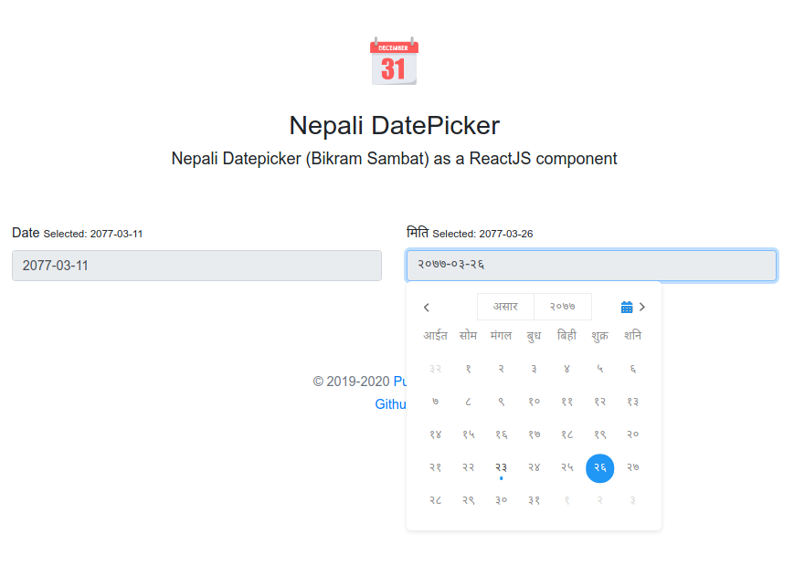

# Nepali Datepicker (Bikram Sambat) - React.js Component

> Nepali Datepicker (Bikram Sambat) as a ReactJS component

[](https://www.npmjs.com/package/nepali-datepicker-reactjs)
[](https://standardjs.com)
[](https://travis-ci.org/puncoz-official/nepali-datepicker-reactjs)
[](https://twitter.com/PuncozNepal)

## [Demo](https://puncoz-official.github.io/nepali-datepicker-reactjs/)



## Install

```bash
npm install --save nepali-datepicker-reactjs

or,

yarn add nepali-datepicker-reactjs
```

## Usage

#### For Typescript
```tsx
import React, { useState } from "react"
import { NepaliDatePicker } from "nepali-datepicker-reactjs"
import "nepali-datepicker-reactjs/dist/index.css"

const App = () => {
    const [date, setDate] = useState<string>("")

    return (
        <form>
            <label htmlFor="date">Date</label>
            <NepaliDatePicker inputClassName="form-control"
                              className=""
                              value={date}
                              onChange={(value: string) => setDate(value)}
                              options={{ calenderLocale: "ne", valueLocale: "en" }} />
        </form>
    )
}

export default App
```

#### For JavaScript
```jsx
import React, { useState } from "react"
import { NepaliDatePicker } from "nepali-datepicker-reactjs"
import "nepali-datepicker-reactjs/dist/index.css"

const App = () => {
    const [date, setDate] = useState("")

    return (
        <form>
            <label htmlFor="date">Date</label>
            <NepaliDatePicker inputClassName="form-control"
                              className=""
                              value={date}
                              onChange={(value) => setDate(value)}
                              options={{ calenderLocale: "ne", valueLocale: "en" }} />
        </form>
    )
}

export default App
```

#### Plain HTML (no build step)
Best for a quick standalone test or a static page with no bundler — pulls React and the picker straight from a CDN as ES modules. For a real app with `npm`/`yarn` already set up, prefer the JS/TS usage above instead.

```html
<!DOCTYPE html>
<html>
<head>
  <meta charset="UTF-8">
  <title>Nepali Datepicker Test</title>
  <link rel="stylesheet" href="https://esm.sh/nepali-datepicker-reactjs/dist/index.css">
  <style>
    body { font-family: Arial, sans-serif; padding: 40px; background: #f5f5f5; }
    .box { max-width: 400px; margin: auto; background: #fff; padding: 20px; border-radius: 8px; }
  </style>
</head>
<body>
  <div class="box">
    <h2>Nepali Datepicker Test</h2>
    <div id="app"></div>
  </div>

  <script type="module">
    import React, { useState, createElement as h } from "https://esm.sh/react@18";
    import ReactDOM from "https://esm.sh/react-dom@18/client";
    import { NepaliDatePicker } from "https://esm.sh/nepali-datepicker-reactjs?bundle&deps=react@18,react-dom@18";

    function App() {
      const [date, setDate] = useState("");
      return h("div", null,
        h("label", null, "Select date: "),
        h(NepaliDatePicker, {
          inputClassName: "form-control",
          value: date,
          onChange: (v) => setDate(v),
          options: { calenderLocale: "ne", valueLocale: "en" }
        })
      );
    }

    ReactDOM.createRoot(document.getElementById("app")).render(h(App));
  </script>
</body>
</html>
```

> **Note:** React and ReactDOM must be imported from the same CDN source (here, esm.sh) as the `deps=` pin the picker resolves against — mixing a UMD `<script>` copy of React with esm.sh's own copy causes "invalid hook call" errors and a blank render.

## Bounding the selectable range (`minDate` / `maxDate`)

`minDate` and `maxDate` take an AD date string (`YYYY-MM-DD`). Days outside the range are disabled and unclickable, and month navigation that would lead entirely outside the range is disabled too.

```tsx
<NepaliDatePicker
    value={date}
    onChange={setDate}
    minDate="2020-01-01"
    maxDate={new Date().toISOString().slice(0, 10)} // e.g. block future dates
/>
```

(`minYear`/`maxYear` still exist separately and bound the year *dropdown list*, not the selectable range.)

## License

MIT © [https://github.com/puncoz-official](https://github.com/puncoz-official)
